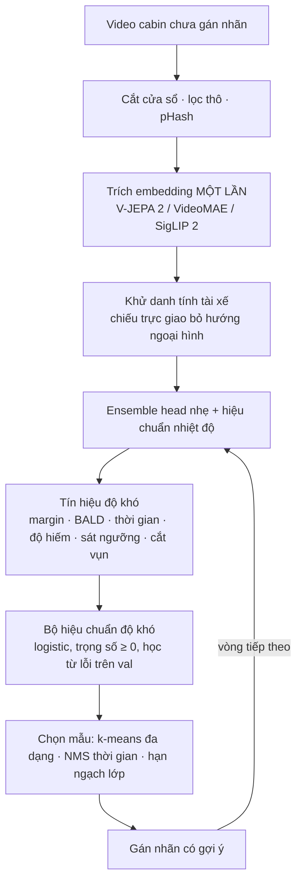
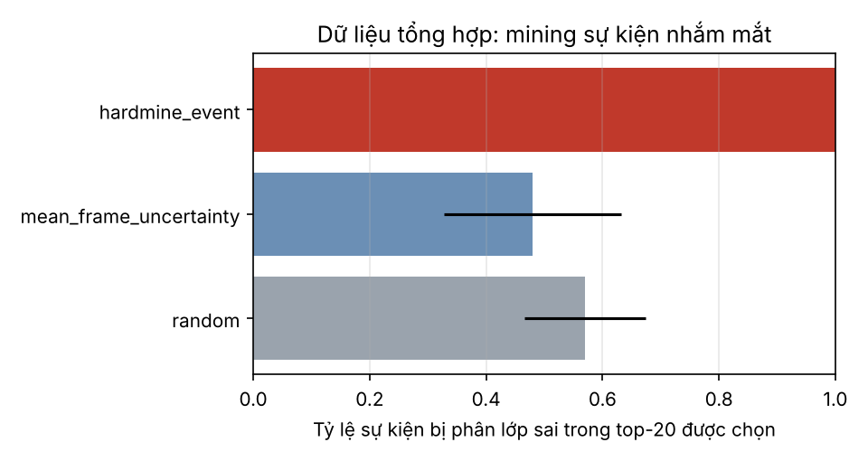
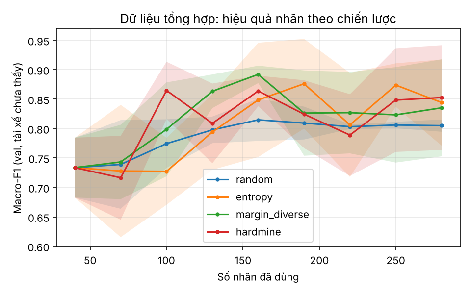

<div align="center">

# HardMine-DMS

**Khai phá ca khó cho video giám sát tài xế (Driver Monitoring System)**

Từ nhiều giờ video cabin chưa gán nhãn, chọn ra đúng những đoạn mà model đang sai —
ở đúng tầng thời gian của trạng thái tài xế — để mỗi giờ gán nhãn giảm được nhiều cảnh báo sai và ca bỏ sót nhất.

[](https://github.com/luuthilananh/Hardmine_DMS/actions/workflows/ci.yml)
[](https://luuthilananh.github.io/Hardmine_DMS/)
[](https://kaggle.com/kernels/welcome?src=https://github.com/luuthilananh/Hardmine_DMS/blob/main/notebooks/kaggle_hardmine.ipynb)

[](LICENSE)

[**Demo tương tác**](https://luuthilananh.github.io/Hardmine_DMS/) · [Kế hoạch nghiên cứu](docs/MILESTONES.md) · [Đặc tả](docs/SPEC.md) · [Luật đánh giá](docs/EVAL_PROTOCOL.md)

</div>

> **Trạng thái: trước v0.1 (đang xây MVP).** Phần toán lõi đã được kiểm chứng bằng test; pipeline chạy đầu-cuối trên
> dữ liệu tổng hợp. **Chưa có kết quả trên dữ liệu thật** — mọi con số bên dưới là kiểm chứng cơ chế.

---

## Vấn đề

Đội DMS có hàng nghìn giờ video cabin và ngân sách gán nhãn nhỏ. Gán nhãn ngẫu nhiên tốn tiền vào hàng giờ "lái xe bình thường"
lặp lại. Active learning chung chung chỉ dựa vào độ bất định của một ảnh, nên bỏ sót những lỗi đặc thù của cabin:
một lần **ngủ 3 giây bị cắt vụn thành hai lần ngủ gật**, một ca **nhắm mắt 1,9 giây sát ngưỡng**, một tài xế mới mà
embedding chỉ "nhìn thấy" khuôn mặt chứ không thấy hành vi.

## Cách tiếp cận

Một engine, ba tầng thời gian. Ngưỡng sự kiện lấy theo [Euro NCAP Driver Engagement 2026](https://cdn.euroncap.com/media/83736/euro-ncap-protocol-safe-driving-driver-engagement-v09.pdf).

| Tầng | Đơn vị mining | Trạng thái tài xế | Tín hiệu đặc thù |
|---|---|---|---|
| Clip | cửa sổ 2 s | hành vi, dùng điện thoại | bất ổn định theo thời gian · bất đồng đa góc · độ hiếm sau khử danh tính tài xế |
| Sự kiện | đoạn nhắm mắt, độ dài thay đổi | ngủ gật 1–2 s · ngủ ≥ 3 s · mất phản ứng ≥ 6 s | **sát ngưỡng** thời lượng · **cắt vụn** bởi khe ngắn |
| Cửa sổ dài | 5–10 phút | buồn ngủ (KSS ≥ 7) | mâu thuẫn xu hướng PERCLOS *(v1.0)* |



Bước đắt (trích embedding) chạy đúng một lần; mỗi vòng mining chỉ chạy trên vector nên tính bằng phút.
Bộ hiệu chuẩn tự học tín hiệu nào thực sự dự báo lỗi ở vòng hiện tại, và tự gán trọng số gần 0 cho tín hiệu vô ích.

## Bắt đầu nhanh (CPU, không cần dữ liệu thật)

```bash
git clone https://github.com/luuthilananh/Hardmine_DMS.git
cd Hardmine_DMS
pip install -e ".[dev]"
pytest -q                              # 20+ test, khoảng 10 giây
python scripts/demo_synthetic.py       # demo đầu-cuối, khoảng 40 giây
```

Kết quả vào `results/synthetic_demo/` (CSV, hình, `summary.md`) và dữ liệu cho trang demo vào `demo/data.js`.

## Chạy với GPU trên Kaggle

Bấm nút **Open in Kaggle** ở trên (hoặc mở [`notebooks/kaggle_hardmine.ipynb`](notebooks/kaggle_hardmine.ipynb)), bật
**GPU** và **Internet** trong Settings, rồi chạy lần lượt. Notebook kiểm tra GPU, chạy test, chạy demo, trích embedding cho
video của bạn (đo thông lượng trước, có resume), và kiểm tra khử danh tính tài xế trên embedding thật.

```bash
python scripts/extract_features.py --videos /path/to/videos --out cache/features/own --preset videomae_base
```

## Kết quả kiểm chứng cơ chế (dữ liệu tổng hợp)

<details open>
<summary>Đọc kỹ trước khi xem số</summary>

Dữ liệu tổng hợp được sinh bởi [`src/hardmine/synthetic/generators.py`](src/hardmine/synthetic/generators.py). Nó không có
cấu trúc thời gian thật, và bộ sinh sự kiện chủ động tạo ra đúng loại lỗi mà tín hiệu sát ngưỡng/cắt vụn nhắm tới.
Vì vậy các bảng này chỉ trả lời câu hỏi *"code có làm đúng điều nó được thiết kế không"*, không phải *"phương pháp có tốt hơn trên dữ liệu thật không"*.
Câu hỏi thứ hai được trả lời ở cổng G3 trên Drive&Act.
</details>

**Tầng sự kiện** — tỷ lệ sự kiện bị phân lớp sai trong 20 sự kiện được chọn (5 chuỗi 30 phút):

| Chiến lược | Tỷ lệ lỗi trong top-20 | Tỷ lệ lỗi nền |
|---|---|---|
| random | 0.57 ± 0.10 | 0.54 |
| bất định frame trung bình | 0.48 ± 0.15 | 0.54 |
| **hardmine_event** | **1.00 ± 0.00** | 0.54 |

Hậu xử lý lấp khe 0,2 s: F1 ngủ 0.65 → 0.94; F1 ngủ gật 0.48 → 0.88.
Đáng chú ý: chọn theo bất định frame trung bình còn **kém hơn ngẫu nhiên**, vì các sự kiện bị cắt vụn có mỗi frame đều rất "chắc chắn".

**Tầng clip** — 4 chiến lược, 8 vòng × 30 nhãn, 3 seed, đánh giá trên tài xế chưa thấy:

| Chiến lược | Macro-F1 val (vòng cuối) | Macro-F1 test | Lift chuẩn hoá |
|---|---|---|---|
| random | 0.805 ± 0.010 | 0.866 ± 0.083 | 0.00 |
| entropy | 0.844 ± 0.073 | 0.913 ± 0.019 | 0.25 |
| margin_diverse | 0.835 ± 0.082 | 0.919 ± 0.026 | 0.39 |
| hardmine | 0.853 ± 0.089 | 0.905 ± 0.033 | 0.34 |

Trên dữ liệu tổng hợp, HardMine **chưa tách biệt** khỏi các baseline bất định — đúng như dự kiến khi dữ liệu thiếu cấu trúc
thời gian. Kết quả này được giữ nguyên, không chọn lại seed.

<p align="center">


</p>

## Cấu trúc repo

```
src/hardmine/
  signals/     tín hiệu độ khó tầng clip (S1–S7)            ✔ đã kiểm chứng
  events/      sự kiện nhắm mắt, sát ngưỡng, cắt vụn, metric  ✔ đã kiểm chứng
  features/    khử danh tính ✔ · trích embedding (GPU)
  select/      bộ hiệu chuẩn độ khó, Pareto, chọn batch       ✔ đã kiểm chứng
  al/          vòng mô phỏng gán nhãn (bản rút gọn CPU)
  eval/        HHR@K, Lift, AUROC lỗi, AUBC, t-test, bootstrap theo tài xế
  synthetic/   dữ liệu tổng hợp có ca khó biết trước
scripts/       demo_synthetic.py · extract_features.py
notebooks/     kaggle_hardmine.ipynb
demo/          trang demo tương tác (GitHub Pages)
docs/          MILESTONES · SPEC · EVAL_PROTOCOL · DATA · DECISIONS · KICKOFF_PROMPT
```

## Lộ trình

| Giai đoạn | Nội dung | Trạng thái |
|---|---|---|
| P0 | Nền móng, toán lõi, CI, demo tổng hợp | đang làm |
| P1 | Loader Drive&Act, khử trùng, trích embedding, khử danh tính trên dữ liệu thật | chờ dữ liệu |
| P2 | Vòng mô phỏng đầy đủ + 8 baseline | |
| P3 | Tín hiệu + bộ hiệu chuẩn → **cổng G3: H1 đạt hay đổi hướng** | |
| P4 | Tầng sự kiện trên dữ liệu thật → **v0.1** | |
| P5–P6 | Đa góc, VLM, chuyển miền DMD, tập NIR tự quay, đánh giá kiểu Euro NCAP → **v1.0** | |

Chi tiết và tiêu chí nghiệm thu: [`docs/MILESTONES.md`](docs/MILESTONES.md).

## Dữ liệu

Repo **không** phân phối dữ liệu. Drive&Act, DMD và các dataset buồn ngủ đều yêu cầu đăng ký và chỉ dùng cho nghiên cứu.
Xem [`docs/DATA.md`](docs/DATA.md).

## Nguyên tắc đánh giá

Chia theo người lái · không chạm tập test khi tinh chỉnh · metric sự kiện thay vì accuracy theo frame ·
báo cáo ô điều kiện tệ nhất và cảnh báo sai mỗi giờ · báo cáo kết quả âm tính. Xem [`docs/EVAL_PROTOCOL.md`](docs/EVAL_PROTOCOL.md).

## Trích dẫn

```bibtex
@software{hardmine_dms_2026,
  author = {Luu, Thi Lan Anh},
  title  = {HardMine-DMS: Temporal hard-case mining for in-cabin driver monitoring},
  year   = {2026},
  url    = {https://github.com/luuthilananh/Hardmine_DMS}
}
```

## Tham khảo chính

- Gupte et al., *Revisiting Active Learning in the Era of Vision Foundation Models* (DropQuery), 2024 — [arXiv:2401.14555](https://arxiv.org/abs/2401.14555)
- Ye et al., *VLMine: Long-Tail Data Mining with Vision Language Models*, WACV-W 2025
- Martin et al., *Drive&Act*, ICCV 2019 · Ortega et al., *DMD*, ECCV-W 2020
- Miyata et al., *Zero-Shot Distracted Driver Detection via VLMs with Double Decoupling*, 2026 — [arXiv:2601.08467](https://arxiv.org/abs/2601.08467)
- Euro NCAP, *Safe Driving – Driver Engagement Protocol*, áp dụng 01/2026

## Giấy phép

Mã nguồn: [MIT](LICENSE). Mỗi dataset và model nền có điều khoản riêng.
